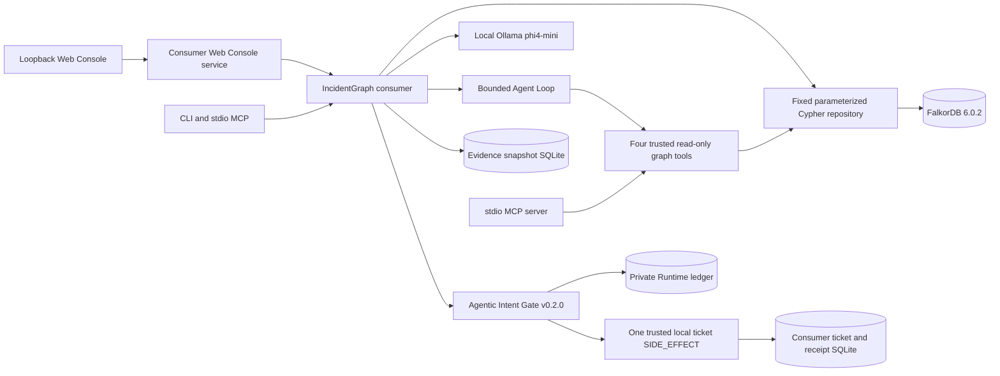

# Architecture

The shared Agentic Intent Gate Runtime is consumed as the installed distribution at immutable commit `7261fdd2f47d2b15fabe8faac527eeee37338eb1`. Its public API owns Plan validation, persistent Runs, exact Approval binding, independent Authorization, durable Action claiming, audit, and terminal Unknown behavior. The consumer registers one trusted local SQLite ticket executor. It does not copy or modify Runtime internals.

The model can select only from fixed tool names and bounded JSON schemas. It cannot provide Cypher, executable code, credentials, target identity, execution scope, or authorization. Application summaries are derived from validated graph evidence, not raw model prose. The Web Console binds to `127.0.0.1`; its confirmation fields are explicit and each Runtime transition is an independent request.

Three separate consumer-owned SQLite identities store Runtime ledger state, evidence snapshots, and the ticket/effect/receipt data. They cannot commit atomically together. Ambiguous effects become Unknown and must not be retried. The only effect creates a local ticket; infrastructure remediation and external ticket APIs are out of scope.
